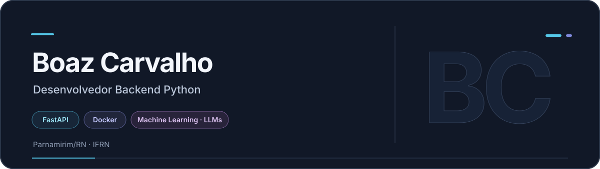
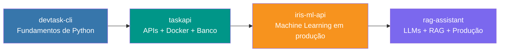

**Desenvolvedor Backend Python** · FastAPI · Docker · Machine Learning e LLMs 
📍 Parnamirim/RN · Estudante de Tecnologia em Sistemas para Internet — IFRN

---

## 👨‍💻 Sobre mim

Desenvolvedor **backend com foco em Python**: construção de **APIs robustas com FastAPI**,
**conteinerização com Docker** e aplicações de **Machine Learning e LLMs (RAG)**.
Tenho base sólida em **Cálculo, Álgebra Linear e Estatística** (três anos de Engenharia),
que aplico em soluções de dados e inteligência artificial. Prezo por arquitetura em camadas,
código testável e boas práticas de versionamento e CI/CD.

Possuo também conhecimentos complementares de **front-end (HTML, CSS, JavaScript e TypeScript)**
e de **C++**, que me permitem atuar de forma full stack quando necessário.

| 🧩 Backend e APIs | 🧠 Dados e IA | ⚙️ Engenharia de software |
|:---:|:---:|:---:|
| Python · FastAPI · APIs robustas | Machine Learning · LLMs · RAG | Arquitetura em camadas · Código testável · CI/CD |

---

## 🧰 Tecnologias e ferramentas

### Backend

### Dados e inteligência artificial

### Infraestrutura e bancos de dados

### Autenticação e conhecimentos complementares

📚 Tecnologias e conhecimentos em detalhe

 

**Backend:** Python 3.12, FastAPI, Pydantic, SQLAlchemy, pytest 
**Dados e IA:** scikit-learn, Pandas, NumPy, embeddings, RAG, integração com APIs de LLM 
**Infraestrutura:** Docker, Docker Compose, Nginx, GitHub Actions (CI/CD), variáveis de ambiente e healthchecks 
**Bancos de dados:** PostgreSQL (SQLAlchemy), SQLite 
**Autenticação:** OAuth2 Password Flow, JWT, hash de senhas (bcrypt) 
**Conhecimentos complementares:** HTML5, CSS3, JavaScript, TypeScript, C++

---

## 📊 Estatísticas do GitHub

---

## 🚀 Projetos

<table>
  <tr>
    <td width="50%" valign="top">
      <h3>01 · <a href="https://github.com/SEU-USUARIO/devtask-cli">devtask-cli</a></h3>
      
Gerenciador de tarefas em linha de comando, com arquitetura em camadas, persistência em JSON e testes unitários.

      
<strong>Tecnologias:</strong> Python, OOP, pytest, argparse

    </td>
    <td width="50%" valign="top">
      <h3>02 · <a href="https://github.com/SEU-USUARIO/taskapi">taskapi</a></h3>
      
API REST completa de gerenciamento de tarefas: autenticação JWT/OAuth2, CRUD isolado por usuário, PostgreSQL e orquestração via Docker Compose com healthchecks.

      
<strong>Tecnologias:</strong> FastAPI, SQLAlchemy, PostgreSQL, JWT, Docker, pytest

    </td>
  </tr>
  <tr>
    <td width="50%" valign="top">
      <h3>03 · <a href="https://github.com/SEU-USUARIO/iris-ml-api">iris-ml-api</a></h3>
      
API de Machine Learning que treina um modelo Random Forest (validação cruzada e métricas), serve predições via FastAPI em container e explica cada previsão em linguagem natural.

      
<strong>Tecnologias:</strong> scikit-learn, Pandas, FastAPI, Docker

    </td>
    <td width="50%" valign="top">
      <h3>04 · <a href="https://github.com/SEU-USUARIO/rag-assistant">rag-assistant</a></h3>
      
Assistente RAG (Retrieval-Augmented Generation): ingestão de documentos, busca semântica, respostas com fontes citadas e respostas em <strong>streaming (SSE)</strong>. Funciona offline e aceita integração com LLMs (OpenAI). Inclui Nginx, CI/CD com GitHub Actions e Docker Compose.

      
<strong>Tecnologias:</strong> FastAPI, vector store, embeddings, SSE, Nginx, GitHub Actions, Docker

    </td>
  </tr>
</table>

### 🧭 Evolução dos projetos

Cada projeto amplia a complexidade do anterior: ferramenta de linha de comando → API web
com banco de dados e autenticação → modelo de Machine Learning servido em produção →
aplicação de IA generativa com streaming e pipeline de CI/CD.

---

## 🎓 Formação acadêmica

- **Tecnologia em Sistemas para Internet (TSI)** — IFRN, Campus Parnamirim (em andamento)
- **Engenharia** — 3 anos cursados: formação matemática sólida em Cálculo, Álgebra Linear, Geometria Analítica, Estatística e Física
- **Informática Básica** — CEEP Lourdinha Guerra, Parnamirim/RN

**Estudos complementares:** Python avançado, FastAPI, Docker e conteinerização, Machine Learning e LLMs/RAG.

---

## 📬 Onde me encontrar

---

*Todos os projetos utilizam Python 3.12, FastAPI, Docker e pytest. Cada repositório inclui documentação com instruções de execução local e via Docker.*

