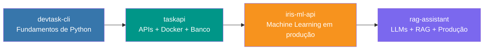

# Boaz Carvalho

**Desenvolvedor Backend Python** · FastAPI · Docker · Machine Learning e LLMs
📍 Parnamirim/RN · Estudante de Tecnologia em Sistemas para Internet — IFRN

---

## Sobre

Desenvolvedor **backend com foco em Python**: construção de **APIs robustas com FastAPI**,
**conteinerização com Docker** e aplicações de **Machine Learning e LLMs (RAG)**.
Tenho base sólida em **Cálculo, Álgebra Linear e Estatística** (três anos de Engenharia),
que aplico em soluções de dados e inteligência artificial. Prezo por arquitetura em camadas,
código testável e boas práticas de versionamento e CI/CD.

Possuo também conhecimentos complementares de **front-end (HTML, CSS, JavaScript e TypeScript)**
e de **C++**, que me permitem atuar de forma full stack quando necessário.

---

## Tecnologias

**Backend:** Python 3.12, FastAPI, Pydantic, SQLAlchemy, pytest
**Dados e IA:** scikit-learn, Pandas, NumPy, embeddings, RAG, integração com APIs de LLM
**Infraestrutura:** Docker, Docker Compose, Nginx, GitHub Actions (CI/CD), variáveis de ambiente e healthchecks
**Bancos de dados:** PostgreSQL (SQLAlchemy), SQLite
**Autenticação:** OAuth2 Password Flow, JWT, hash de senhas (bcrypt)
**Conhecimentos complementares:** HTML5, CSS3, JavaScript, TypeScript, C++

---

## Projetos

| # | Projeto | Descrição | Tecnologias |
|---|---------|-----------|-------------|
| 1 | [**devtask-cli**](https://github.com/SEU-USUARIO/devtask-cli) | Gerenciador de tarefas em linha de comando, com arquitetura em camadas, persistência em JSON e testes unitários. | Python, OOP, pytest, argparse |
| 2 | [**taskapi**](https://github.com/SEU-USUARIO/taskapi) | API REST completa de gerenciamento de tarefas: autenticação JWT/OAuth2, CRUD isolado por usuário, PostgreSQL e orquestração via Docker Compose com healthchecks. | FastAPI, SQLAlchemy, PostgreSQL, JWT, Docker, pytest |
| 3 | [**iris-ml-api**](https://github.com/SEU-USUARIO/iris-ml-api) | API de Machine Learning que treina um modelo Random Forest (validação cruzada e métricas), serve predições via FastAPI em container e explica cada previsão em linguagem natural. | scikit-learn, Pandas, FastAPI, Docker |
| 4 | [**rag-assistant**](https://github.com/SEU-USUARIO/rag-assistant) | Assistente RAG (Retrieval-Augmented Generation): ingestão de documentos, busca semântica, respostas com fontes citadas e respostas em **streaming (SSE)**. Funciona offline e aceita integração com LLMs (OpenAI). Inclui Nginx, CI/CD com GitHub Actions e Docker Compose. | FastAPI, vector store, embeddings, SSE, Nginx, GitHub Actions, Docker |

### Evolução dos projetos

Cada projeto amplia a complexidade do anterior: ferramenta de linha de comando → API web
com banco de dados e autenticação → modelo de Machine Learning servido em produção →
aplicação de IA generativa com streaming e pipeline de CI/CD.

---

## Formação acadêmica

- **Tecnologia em Sistemas para Internet (TSI)** — IFRN, Campus Parnamirim (em andamento)
- **Engenharia** — 3 anos cursados: formação matemática sólida em Cálculo, Álgebra Linear, Geometria Analítica, Estatística e Física
- **Informática Básica** — CEEP Lourdinha Guerra, Parnamirim/RN

**Estudos complementares:** Python avançado, FastAPI, Docker e conteinerização, Machine Learning e LLMs/RAG.

---

## Contato

---

*Todos os projetos utilizam Python 3.12, FastAPI, Docker e pytest. Cada repositório inclui documentação com instruções de execução local e via Docker.*
